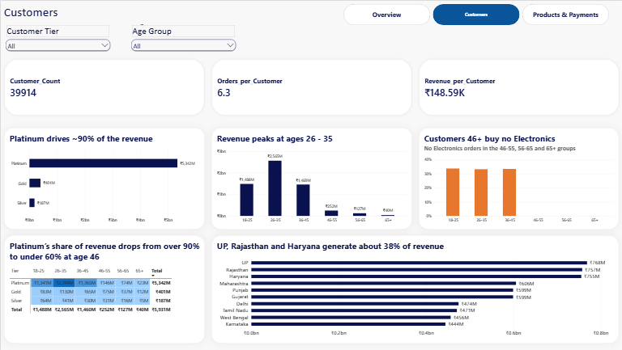
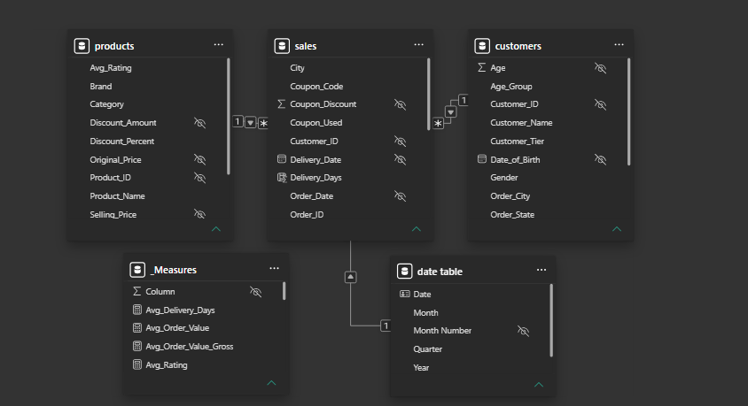
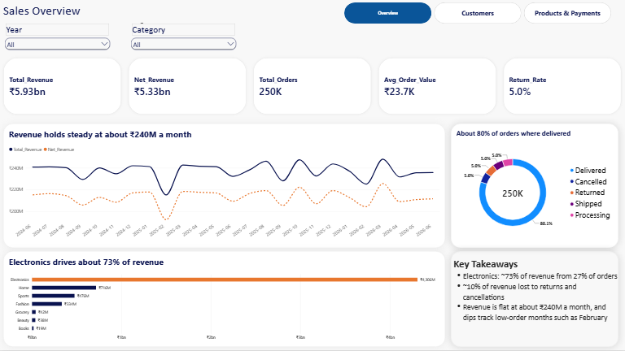
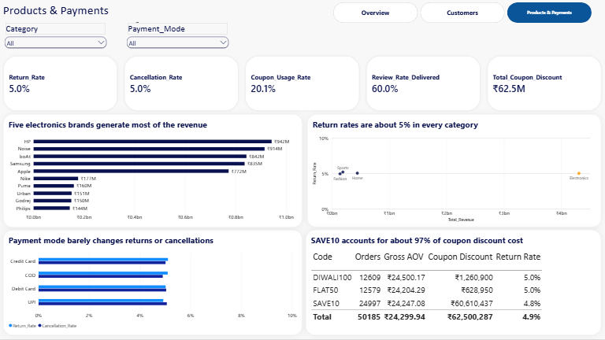

# Indian E-Commerce Sales Analytics: Power BI Dashboard

An end-to-end Power BI project on a relational e-commerce dataset (250,000 orders, 40,000 customers, 2,000 products). It covers data cleaning in Power Query, a star-schema data model, DAX measures, exploratory analysis, and a three-page interactive dashboard.



## Project goal

Understand what drives revenue, who the high-value customers are, and whether payment method, coupons or product category change return, cancellation and review behaviour.

**Business questions**
1. Which categories and brands drive revenue, and which have high return rates?
2. How does revenue vary by customer tier, age group and state?
3. Does payment mode affect returns or cancellations?
4. Do coupons increase basket size, and what do they cost?
5. Do review rates vary by category?

## Dataset

Indian E-Commerce Sales Analytics Dataset (shared for educational and portfolio use): https://www.kaggle.com/datasets/jatinkhandelwal112/indian-e-commerce-sales-analytics-dataset

| Table | Rows | Description |
|---|---|---|
| `customers` | 40,000 | Demographics, registration date, tier, registered city and state |
| `products` | 2,000 | Category, brand, prices, discounts, ratings |
| `sales` | 250,000 | Orders: dates, quantity, amounts, coupons, payment mode, status, rating |

Orders cover **June 2024 to June 2026** (25 months). 39,914 customers placed at least one order.

## Tools and skills

- **Power Query:** type fixing, trimming and standardising text, validation checks, conditional columns
- **Data modelling:** star schema, one-to-many relationships, a dedicated date table, hidden helper columns
- **DAX:** explicit measures, `CALCULATE`, `DIVIDE`, `DISTINCTCOUNT`, time intelligence
- **Visualisation:** KPI cards, conditional formatting, slicers, page navigation, insight-led titles

## Data cleaning

- Confirmed correct data types for all three tables and checked for missing values.
- Standardised text fields (Gender, Category, Brand, Payment_Mode, Order_Status) and rebuilt the customer age grouping with a conditional column.
- Validated business logic with temporary check columns, then removed them:
  - `Selling_Price = Original_Price - Discount_Amount`
  - `Discount_Percent` consistent with the amounts
  - `Total_Amount` consistent with `Order_Value`, `Shipping_Cost` and `Coupon_Discount`
  - `Delivery_Date` never earlier than `Order_Date`
  - `Order_ID` unique; no future or implausible dates of birth; pincodes all 6 digits
- Kept expected nulls instead of deleting them: `Coupon_Code` (no coupon used), and `Rating` / `Review_Text` (not every order is reviewed).
- Added `Coupon_Used` (Yes/No) to make coupon analysis simple.
- Renamed sales `City` and `State` to `Order_City` and `Order_State`, because they differ from the customer's registered location.
- Removed duplicate age columns from `sales` and personal data (email, phone) from `customers`.

## Data model



`sales` is the fact table, with `customers` and `products` as dimensions (one-to-many, single direction) and a date table linked on `Order_Date`. Keys and raw numeric columns are hidden, so reports use explicit measures only.

**Key measures** (DAX)

```
Total_Revenue   = SUM(sales[Total_Amount])
Total_Orders    = DISTINCTCOUNT(sales[Order_ID])
Avg_Order_Value = DIVIDE([Total_Revenue], [Total_Orders])

Net_Revenue =
CALCULATE([Total_Revenue], NOT sales[Order_Status] IN {"Cancelled", "Returned"})

Return_Rate =
DIVIDE(CALCULATE([Total_Orders], sales[Order_Status] = "Returned"), [Total_Orders])

Electronics_Order_Share =
DIVIDE(CALCULATE([Total_Orders], product_table[Category] = "Electronics"), [Total_Orders])

Review_Rate_Delivered =
DIVIDE(
    CALCULATE(COUNTROWS(sales), NOT ISBLANK(sales[Rating]), sales[Order_Status] = "Delivered"),
    CALCULATE([Total_Orders], sales[Order_Status] = "Delivered")
)
```

Other measures: `Cancellation_Rate`, `Coupon_Usage_Rate`, `Avg_Order_Value_Gross` (before discount), `Delivered_Revenue`, `Customer_Count`, `Total_Coupon_Discount`, `Revenue_PY`, `Revenue_MoM_Pct`.

## Dashboard

| Page | What it shows |
|---|---|
| **Overview** | Revenue, net revenue, orders, AOV and return rate; monthly revenue; orders by status; revenue by category |
| **Customers** | Revenue by tier and age group, Electronics share by age, tier x age heat map, revenue by registered state |
| **Products & Payments** | Top brands, category return rates, payment mode vs returns and cancellations, coupon performance |




## Key findings

**Revenue and products**
- Total revenue is **₹5.93bn** across 250,000 orders (average order value ₹23.7K). **Net revenue is ₹5.33bn**: about 10% of revenue is lost to returns and cancellations.
- **Electronics generates about 73% of revenue from 27% of orders**, with no return penalty (5.0%). One Electronics order is worth roughly 30 to 70 times a Grocery, Beauty or Books order.
- Brand revenue ranking is driven by order value, not volume. HP, Noise, boAt, Samsung and Apple average ₹58K to ₹71K per order. Nike and Puma have more orders but about ₹10K to ₹11K per order.
- Monthly revenue is **flat at about ₹240M**, with about 10K orders a month. Dips in February are just a shorter month.

**Customers**
- **Platinum customers generate about 90% of revenue.** Their share falls to about 58% for customers aged 46 and over.
- Customers aged **18 to 45 generate about 93% of revenue**. Customers 46 and over place **no Electronics orders**, and their average order value falls to about ₹8.2K to ₹8.4K (roughly the non-Electronics average). Orders per customer are about 6.3 in every age group, so the gap comes from basket size, not frequency.
- Uttar Pradesh, Rajasthan and Haryana together generate about 38% of revenue. Revenue per customer is similar across the 10 states (₹146K to ₹152K).

**Behaviour**
- Return and cancellation rates barely move by category, payment mode, brand, coupon or state. Every group sits roughly between 4.7% and 5.4%, which is within the range random variation produces at these volumes.
- Payment mode does not change returns or cancellations. UPI is the most used method (about 51% of orders).
- **Coupons do not increase basket size.** Gross order value is about ₹24.3K for coupon orders against ₹23.9K without a coupon (1.7% apart). SAVE10 accounts for about 97% of the ₹62.5M discount cost (about 1% of revenue).
- Only delivered orders have ratings: **60% of delivered orders are reviewed** (48% of all orders). Review rate and average rating (about 4.4) are uniform across categories.

## Definitions

- **Revenue** is `Total_Amount`: it includes shipping and is net of coupon discounts.
- **Net revenue** excludes cancelled and returned orders. It still includes orders that are shipped or processing.
- **Delivered revenue** counts delivered orders only (₹4.74bn). It matches the customers table's `Total_Spent`, so that column only counts delivered orders.
- **Gross AOV** uses `Order_Value` (before the coupon discount) for fair coupon comparisons.
- **State analysis** uses the customer's registered state. Order locations in `sales` differ from registered locations.

## Limitations

- The dataset looks **synthetic**. Many rates are almost identical across groups, so I report "no meaningful difference" instead of inventing explanations.
- The association between tier, age and Electronics buying is descriptive. Customer tier may be defined by spend, in which case its link to revenue is partly built in. I haven't verified this.
- Promotional impact is not measurable here, since there is no baseline for orders that would have happened without a coupon.

## Repository contents

```
├── Sales Dataset Project.pbix
├── README.md
└── images/
    ├── 01-overview.png
    ├── 02-customers.png
    ├── 03-products-payments.png
    └── 04-data-model.png
```

**To explore:** open the `Sales Dataset Project.pbix` in Power BI Desktop (free) and use the slicers and page navigator.

## About me

Muhammed Asiwaju Abdul Lateef | Data analyst | www.linkedin.com/in/muhammed-abdul-lateef-5b5190229 | abdullateefmuhammed0001@gmail.com

Other projects: [Excel customer churn analysis (MTN Nigeria dataset)](GitHub: https://lnkd.in/eZEwBYny)
